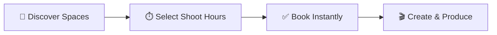
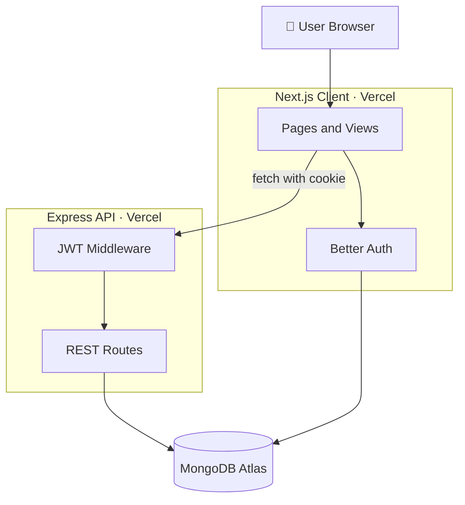

<div align="center">

<!-- Optional: put a logo at docs/logo.png and uncomment the next line -->
<!--  -->

# 📸 StudioSpace

### Book creative studios in minutes, or earn by hosting yours.

A peer-to-peer marketplace for photographers, filmmakers, podcasters, and musicians to discover, reserve, and share production spaces.

<br />

[](https://studiospace-bd.vercel.app/)
[](https://github.com/Kowshikkantidasbd/studiospace)
[](https://github.com/Kowshikkantidasbd/studiospace-api)


</div>

---

## 📑 Table of Contents

- [About](#-about)
- [Highlights](#-highlights)
- [Features](#-features)
- [How It Works](#-how-it-works)
- [Tech Stack](#-tech-stack)
- [Architecture](#-architecture)
- [Getting Started](#-getting-started)
- [Examiner Test Credentials](#-examiner-test-credentials)
- [Routes](#-routes)
- [Project Structure](#-project-structure)
- [Author](#-author)

---

## 🎬 About

**StudioSpace** connects people who own creative spaces with creators who need them. Hosts list photography cyc walls, cinema sound stages, podcast lounges, music recording suites, and art workshops. Creators browse, filter, and reserve slots with transparent hourly pricing, while the platform keeps every booking organized and collision-free.

---

## ⚡ Highlights

| 🔐 Secure | 📅 Reliable | 🎨 Polished |
|:---:|:---:|:---:|
| Better Auth, Google login, JWT in HTTPOnly cookies | Double-booking prevention on confirmed slots | Light/dark theme, skeleton loaders, toasts, custom modals |

---

## ✨ Features

### 👤 For Creators
- 🔍 **Explore Studios** in a responsive grid with category badges, hourly rate, rating, and location
- 🗂️ **Browse by Category**: Photo Studios, Sound Stages, Podcast Rooms, Music Suites, Art Workshops
- 📅 **Instant Booking** through a booking modal, with status tracking (Pending, Confirmed, Completed, Cancelled)
- ❌ **Cancel Pending Bookings** from the My Bookings page
- ❤️ **Saved Studios Wishlist** to keep your favorite spaces in one place

### 🏠 For Hosts
- ➕ **Add New Studio** with category, pricing, deposit, capacity, amenities, and images
- ✏️ **Edit Listings** with a pre-filled form
- 🗑️ **Delete Listings** safely with a confirmation modal
- 📋 **My Listings** dashboard showing only your own spaces

### 🛠️ Platform
- 🚫 **Double-Booking Prevention**: overlapping requests against confirmed bookings are rejected with a clear message
- 🛡️ **Protected API**: server mutations require a JWT in an HTTPOnly cookie and return `401 Unauthorized` otherwise
- 🔒 **Private Routes** that keep you logged in after a page reload
- 🌗 **Light / Dark Theme** toggle across the whole app
- 🔔 **Toasts and Modals** for every action (no browser `alert()`)
- ⏳ **Skeleton Loaders**, a custom **404 page**, and friendly **empty states**
- 📱 **Fully Responsive** on mobile, tablet, and desktop

---

## 🧭 How It Works



1. **Discover Spaces**: browse or filter studios by category
2. **Select Shoot Hours**: pick your date and time slot
3. **Book Instantly**: the server checks for conflicts and saves a Pending booking
4. **Create & Produce**: show up and make something great

---

## 🛠️ Tech Stack

| Layer | Technology |
|---|---|
| **Frontend** | Next.js (App Router), React, TypeScript, Tailwind CSS |
| **Authentication** | Better Auth, MongoDB Adapter, JWT (HTTPOnly cookies) |
| **Backend** | Node.js, Express.js |
| **Database** | MongoDB Atlas |
| **Deployment** | Vercel (client and server) |

---

## 🏗️ Architecture



---

## 🚀 Getting Started

### Prerequisites
- Node.js 18 or later
- A MongoDB Atlas connection string
- A Google OAuth client (for Google login)

<details>
<summary><b>1️⃣ Run the server</b></summary>

```bash
git clone https://github.com/Kowshikkantidasbd/studiospace-api.git
cd studiospace-api
npm install
```

Create a `.env` file in the server folder with your MongoDB connection string and secrets, then start it:

```bash
npm start
```

</details>

<details>
<summary><b>2️⃣ Run the client</b></summary>

```bash
git clone https://github.com/Kowshikkantidasbd/studiospace.git
cd studiospace
npm install
```

Create a `.env` file in the client root:

```env
MONGODB_URI=your_mongodb_connection_string
BETTER_AUTH_SECRET=your_random_secret
BETTER_AUTH_URL=http://localhost:3000
GOOGLE_CLIENT_ID=your_google_client_id
GOOGLE_CLIENT_SECRET=your_google_client_secret
NEXT_PUBLIC_API_URL=http://localhost:5000
```

Start the development server:

```bash
npm run dev
```

Open [http://localhost:3000](http://localhost:3000) in your browser.

</details>

> ⚠️ Start the server first, otherwise studio data will not load.

---

## 🔑 Examiner Test Credentials

| Role | Email | Password |
|:---:|:---:|:---:|
| 🧪 Test User | `YOUR_TEST_EMAIL` | `YOUR_TEST_PASSWORD` |

You can also register a new account (the password needs an uppercase letter, a lowercase letter, and at least 6 characters) or continue with Google.

---

## 🗺️ Routes

| Route | Access | Description |
|---|:---:|---|
| `/` | 🌐 Public | Home page |
| `/studios` | 🌐 Public | Explore all studios |
| `/studios/[id]` | 🌐 Public | Studio details and booking |
| `/login`, `/register` | 🌐 Public | Authentication |
| `/add-studio` | 🔒 Private | Add a new studio |
| `/my-listings` | 🔒 Private | Manage your listings |
| `/studios/edit/[id]` | 🔒 Private | Update a studio |
| `/my-bookings` | 🔒 Private | View and cancel bookings |
| `/saved-studios` | 🔒 Private | Your wishlist |
| `/profile` | 🔒 Private | Your profile |

---

## 🗂️ Project Structure

```
studiospace/
├── public/            # Static assets and uploads
└── src/
    ├── app/           # App Router pages and layout
    ├── views/         # Page-level UI (Home, Explore, Details, Listings, Bookings, ...)
    ├── components/    # Navbar, Footer, StudioCard, BookingModal, ConfirmDeleteModal, SkeletonCard, ...
    ├── context/       # AuthContext and ThemeContext
    ├── lib/           # Better Auth server and client setup
    └── proxy.ts       # Private route protection
```

---

## 👨‍💻 Author

<div align="center">

**Kowshik Kanti Das**
Computer Engineering Diploma Trainee · BSPI, Kaptai

[](https://github.com/Kowshikkantidasbd)
[](https://linkedin.com/in/kowshikkantidas)
[](https://kowshik-kanti-das.web.app)

<br />

⭐ If you like this project, give it a star!

Made with ❤️ for creators everywhere.

</div>